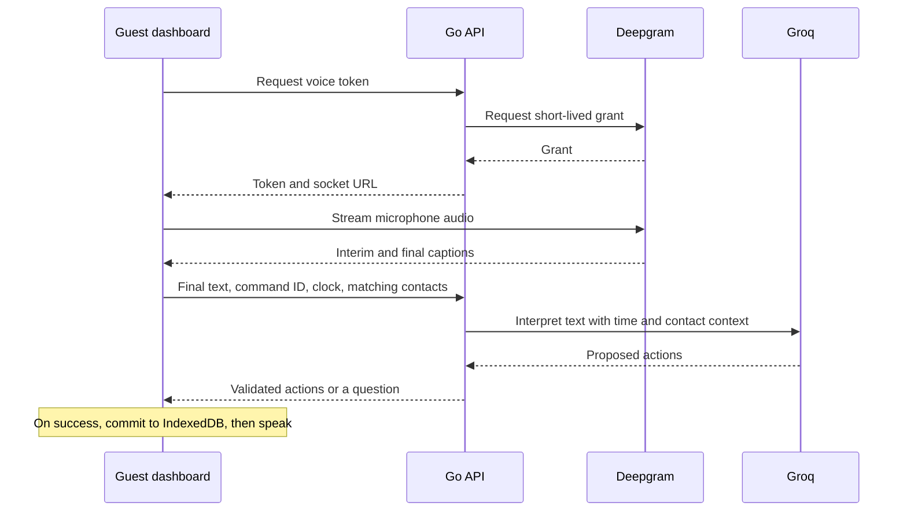

# Morning project documentation

Morning is a browser-based voice assistant. Open [Morning](https://morning.atuls.me/), choose **Try Morning**, then click **Talk to Morning** in the guest dashboard. Allow microphone access, say the sentence below, and click **Stop listening**.

> Draft Priya an email asking for the slides, and remind me in ten minutes to follow up.

I built Morning because those two jobs belong together. If the assistant writes the email but drops the reminder, I still have to remember to follow up. If it saves just the reminder, I come back in ten minutes to an email I still have to write. Morning saves both results together and lets me open each one.

I'm Atul Kumar, the solo builder. I chose the guest workflow, designed the voice interaction, and coordinated the integration of the browser, Go API and speech services through deployment. [My contribution](#my-contribution) describes where I used AI coding assistants.

## Try the guest dashboard

1. Choose **Try Morning** on the landing page. It opens the guest workspace at `/app`. You can use your microphone without an account or personal API keys. Priya Shah is already in **Contacts**, labeled as a sample contact with the address `priya.shah@example.com`.
2. Click the orb or its **Talk to Morning** label. Once the control reads **Stop listening**, say the slides request above. Live captions appear below the orb. Pause after "slides" if you like. The interim words may change as you speak.
3. Click **Stop listening** after "follow up." For push-to-talk on a focused dashboard, hold the physical **Right Ctrl** key instead and release it when you finish. Releasing during mic permission or connection setup cancels that hold.
4. After the save, the draft opens in **Quick View**. The browser says "Draft saved" and reads the reminder title and due time if speech is available. Close Quick View to see both rows beneath the transcript. Open the reminder row to see when the follow-up is due. If playback fails, **Retry speech** repeats the confirmation without submitting the command again.
5. Open the draft, choose **Edit**, change the subject or message, then select **Save changes**. Refresh the guest dashboard and open the draft again. In the same browser profile, the saved wording and the separate reminder load from IndexedDB. You can copy or download the draft as plain text. Sending it is up to you. The reminder stores the due time but has no alert.

## Follow one command through the code

The React dashboard captures audio and stores the results. The Go API gets a temporary transcription token and checks the actions Groq proposes. This trace follows app commit `7ac288f`, the revision in the [Azure deployment run](https://github.com/0atxl/morning/actions/runs/41641704878).



### Capture the complete sentence

`VoiceCapture` obtains the mic with `getUserMedia` and calls `POST /api/voice/token`. Go requests a 30-second grant with its server-side key. The browser checks the returned WebSocket destination and uses the grant to stream MediaRecorder chunks directly to Deepgram Nova-3. Morning's Go process never receives the audio. [Capture code](../web/src/lib/voice-capture.ts) · [Token and destination checks](../web/src/lib/command-api.ts) · [Go grant request](../server/providers.go)

A pause after "slides" can produce a final caption for the first half of the sentence. Submitting it immediately would lose the follow-up. Morning keeps final segments in audio order and replaces interim text as Deepgram revises it. Stop flushes the last audio chunk and sends `CloseStream`. Only finalized words, end metadata and a clean socket close let capture finish. An interrupted stream leaves the words on screen with a retry. [Transcript buffer](../web/src/lib/transcript.ts) · [Capture finalization](../web/src/lib/voice-capture.ts)

### Interpret the request and check both actions

The dashboard creates a `command_id` and posts the final transcript, current time, IANA timezone and matching contacts to `/api/commands`. For "Priya", the local lookup supplies her ID, name and email address. Go sends the text, localized time, timezone and matching contact data to Groq. It keeps the command ID out of the model's input. Groq receives the transcript as data and returns structured JSON. It has no tools to write records or send email. [Browser request](../web/src/hooks/use-reminder-flow.ts) · [Contact lookup](../web/src/lib/contacts.ts) · [Groq request and schema](../server/providers.go)

Suppose the browser submits the command at 09:00 in Kolkata. The expected `draft_email` points to `sample-priya-shah` and contains a subject and body asking for the slides. The expected `create_reminder` has a follow-up title and a due time of 09:10 that day, with the local offset `+05:30`. Groq supplies the wording and resolves "in ten minutes." Go checks the recipient, action fields, future timestamp and timezone offset before echoing the original command ID with the result. [Command handler](../server/api.go) · [Action validation](../server/validation.go)

Two failures need checks beyond the JSON schema.

- **Two people named Priya.** If the guest has also added a second Priya, Go derives matching choices from the contacts supplied with the command. The dashboard shows names and addresses and saves neither result yet. Selecting a contact resubmits the original ID, transcript, clock and contacts with the chosen ID. Time spent choosing cannot move the original ten-minute reference point. For a missing contact, add the person and record the full command again. [Recipient resolution](../server/contacts.go) · [Selection and resubmission](../web/src/lib/command-api.ts)
- **Only half the request comes back.** A single well-formed reminder can pass the schema. Go checks explicit English patterns such as "draft … an email … and remind me" in either order. A missing action for that wording is an error and nothing saves. A clarification also carries zero actions. The guard covers recognized phrasing. It cannot prove the meaning of every paraphrase. [Completeness check](../server/validation.go) · [Partial-response fixture cases](../server/drafts_test.go)

### Save once and speak the result

The browser checks the echoed ID and action list, then resolves the draft's recipient against the contacts it originally supplied. `commitCommand` writes the draft, reminder and a receipt keyed by command ID in one IndexedDB transaction. Only the transaction's completion triggers the result rows and browser speech synthesis. The spoken time comes from the saved reminder. [Response parser](../web/src/lib/command-api.ts) · [Storage transaction](../web/src/lib/reminder-store.ts) · [Confirmation text and playback](../web/src/hooks/use-reminder-flow.ts)

A retry after a dropped response could otherwise create a second reminder. The dashboard reuses the request ID for a network retry. If interpretation succeeded but storage failed, it retries the cached actions locally. An existing receipt returns the saved records, including later draft edits, without a second success announcement. Recording the sentence again starts a new command. [Retry handling](../web/src/hooks/use-reminder-flow.ts) · [Storage fixture cases](../web/tests/workspace-storage.test.ts)

IndexedDB holds the guest address book, reminders, drafts, receipts and the transcript attached to each saved result. Manual edits stay on this site in this browser profile. Clearing site data removes those records. During capture, audio retained for a retry stays in memory. For spoken confirmation the dashboard passes text to the browser's speech engine, whose voice can depend on the device. [Quick View editor](../web/src/components/result-quick-view.tsx) · [Browser store](../web/src/lib/reminder-store.ts)

## Feature status

The table describes what the guest UI calls in the shipped source. The verification record below identifies which paths have run in CI. [Guest dashboard](../web/src/App.tsx) · [Browser action types](../web/src/lib/command-api.ts) · [Go routes](../server/api.go)

| Capability | Where it works | Behavior and limits |
| --- | --- | --- |
| Reminders | Guest dashboard | Create a reminder and edit its title or due time in Quick View. Due reminders show an in-app alert and chime while the dashboard is open. Owner email requires the Gmail setup in the deployment guide. |
| Email drafts | Guest dashboard | Review, edit, copy or download an unsent draft. Morning has no mail delivery integration. |
| Contact clarification | Guest dashboard | Choose among matching contacts before saving. A missing contact or missing reminder time requires a complete revised recording. |
| Spoken confirmation | Guest dashboard | Hear the browser read back a new save and retry playback separately. |
| Spoken reminder corrections | Go API only | The API accepts an existing reminder context and can return `reschedule_reminder`. The dashboard edits reminders by hand and supplies no such context. [Correction handler](../server/corrections.go) |
| Calendar export | Go API event data only | Go can return `create_calendar_event` with start, end and timezone. The dashboard produces no `.ics` file and books no event. [Event validation](../server/validation.go) |
| Meeting minutes | Go API only | `POST /api/minutes` accepts a completed transcript and returns a summary, decisions, action items and open questions. The dashboard has no meeting recorder, minutes editor or minutes download. [Minutes handler](../server/minutes.go) |
| ElevenLabs playback | Go API only | A configured `POST /api/speech` can return Flash v2.5 MP3 audio. The guest dashboard uses browser speech. [Speech handler](../server/speech.go) |
| Design preview | Sample UI | PAD and PEN illustrate minutes and corrections in Activity. Preview controls use sample data. Edits reset on refresh. [Activity stages](../web/src/lib/execution.ts) · [Preview state](../web/src/fixtures/use-design-preview.ts) |
| Search | Unavailable | Neither the guest dashboard nor the API implements search. |

## My contribution

I built Morning as a solo project. I scoped the first interaction around something a guest could inspect on screen. I chose live captions, an explicit finish gesture and Quick View so someone could see what the mic heard, decide when the request was complete and correct the saved draft before using it.

I coordinated the contract between the TypeScript client and the Go API, the Deepgram and Groq integrations, and the Azure release. My debugging work included tracing what happened when a pause split the captions, a model dropped half the command, or a save had to be retried. Those cases shaped when Morning asks a question, writes to storage and speaks.

I used AI coding assistants to help implement the frontend and backend, write fixtures, review integration issues and prepare deployment changes and documentation. I made the scope, interaction and release decisions.

## Run locally

Use Git, Go 1.22 or newer, Node.js 22.12 or newer with npm, and a browser with microphone access on localhost or HTTPS. For the first terminal, clone the repo and prepare the server environment.

```sh
git clone https://github.com/0atxl/morning.git
cd morning/server
[ -e .env ] || cp .env.example .env
```

Edit `server/.env` with your own settings. The Go process reads its environment at startup. Keep credentials on the server.

| Variable | Required for local startup? | Purpose |
| --- | --- | --- |
| `DEEPGRAM_API_KEY` | Yes | Grant short-lived transcription tokens. |
| `GROQ_API_KEY` | Yes | Interpret voice commands and meeting transcripts. |
| `LISTEN_ADDR` | Optional | Override the default API address of `127.0.0.1:8080`. |
| `ELEVENLABS_API_KEY`, `ELEVENLABS_VOICE_ID` | Optional, set together | Enable the server's MP3 speech endpoint. |

In the same terminal, load the file and start Go.

```sh
set -a
. ./.env
set +a
go run -buildvcs=false .
```

In a second terminal opened at the cloned repository root, start the dashboard.

```sh
cd web
npm ci --ignore-scripts
npm run dev
```

Open the URL printed by Vite and choose **Try Morning**. Vite forwards `/api` to Go on its default address. [Server setup](../server/README.md#local-startup) · [Environment template](../server/.env.example) · [Web setup](../web/README.md#start-locally)

## Deploy to Azure and identify the release

GitHub Actions builds on pushes to `main` that change the app, deployment files or deployment workflow. It also supports manual dispatch. The build compiles the Go Linux binary, type-checks TypeScript, builds the Vite assets and packages them with `deployment.json`. When production deployment is enabled, a separate job transfers that artifact to the Azure VM. The release receiver checks the commit and run URL, switches the active release and restarts the API. nginx serves the web files and proxies `/api` on the same origin. [Workflow](../.github/workflows/deploy.yml) · [Release receiver](../deploy/receive.py) · [Deployment setup and rollback](../deploy/README.md)

To identify the deployed app, read `commit` in the site's deployment metadata and follow `workflow_run` to the Actions run that built it. A README or project-guide edit does not trigger an app deployment, so the newest documentation commit can differ from the active app commit. [Public deployment metadata](https://morning.atuls.me/deployment.json)

## Verification and limitations

The public Actions history on 3 November 2026 records three runs. Compilation, service activation and fixture tests each establish something different.

| Existing run | Commit covered | Recorded outcome |
| --- | --- | --- |
| [Backend fixtures · 41622302698](https://github.com/0atxl/morning/actions/runs/41622302698) | `0b0f4038d2c9c39554c8498f4b1655cc106d31a8` | The runner checked out this revision for `go test -count=1 -v ./...`. All 12 top-level tests and 55 subtests passed with zero skips. They covered the reminder contract, time and input validation, token grants, rate limits and provider error handling using fixtures. The workflow dispatch itself was at `3dcb632`. |
| [First build workflow · 41637149423](https://github.com/0atxl/morning/actions/runs/41637149423) | `9eb9cd0b28b38e8a59dfa0b944769991e7364a0d` | The source check found no committed frontend. The workflow finished successfully with compilation and deployment skipped. |
| [Build and Azure deployment · 41641704878](https://github.com/0atxl/morning/actions/runs/41641704878) | `7ac288f5466248fe4905bf6e2d2cdeef8e105c9c` | Go compilation, TypeScript checking, Vite build and packaging succeeded. The Azure receiver logged activation of this SHA. The workflow ran no fixtures, browser checks or live-provider calls. |

The fixture run predates email drafts and the guest dashboard. The repository contains later cases for compound commands, browser storage and the additional API endpoints, but these runs give no result for those cases. [Manual fixture workflow](../.github/workflows/backend-tests.yml) · [Backend cases](../server/) · [Frontend cases](../web/tests/)

There is no recorded live browser verification for this release. The slides walkthrough follows the shipped source. A physical mic producing captions through Deepgram, Groq returning both actions, the browser speaking after save, and the edited draft surviving refresh remain unverified end to end. No app, test suite, smoke check or provider call was run to prepare this guide.
