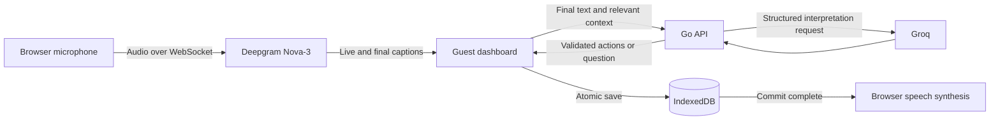

# Morning project documentation

Morning is a browser-based voice assistant that turns a spoken request into a saved reminder and an editable email draft. Open [Morning](https://morning.atuls.me/), choose **Try Morning**, and use the guest dashboard without an account or your own API keys.

> "Draft Priya an email asking for the slides, and remind me in ten minutes to follow up."

That sentence contains two jobs. A draft without the follow-up loses the second intention; a reminder without the draft leaves the first job undone. Morning's connected command flow interprets both, validates the result, and saves them together before speaking a confirmation. It prepares email but never sends it. A reminder currently stores a due time; it does not deliver an alert.

I am Atul Kumar, the solo builder. I scoped the product, directed the voice interaction and UI, integrated the browser with the Go API and speech providers, and coordinated debugging and deployment with AI coding assistants. [My contribution](#my-contribution) explains that division of work.

This document describes source inspected on `main` at [`7ac288f5466248fe4905bf6e2d2cdeef8e105c9c`](https://github.com/0atxl/morning/commit/7ac288f5466248fe4905bf6e2d2cdeef8e105c9c), on 3 November 2026. Connected behavior below means implemented in that checkout, not independently verified with a live microphone. See [verification and limitations](#verification-and-limitations) for the actual evidence.

## Why I built it

Speaking a request is useful only if the assistant preserves what the person asked for and produces something they can inspect. Morning focuses on a small, visible result: a draft to review and a reminder with an explicit date and time. Guest access removes account setup from that first interaction. Browser storage lets the user keep and edit the results without adding an account database.

The compound example is the central product decision. Morning must finish both parts or ask a question before saving either. The user should not have to infer which half of a sentence the assistant remembered.

## Try the guest dashboard

1. Start at [https://morning.atuls.me/](https://morning.atuls.me/) and select **Try Morning**. It opens `/app`, the guest workspace. A direct visit to [the dashboard](https://morning.atuls.me/app) opens the same route.
2. Click the orb, mic, or **Talk to Morning** control and allow microphone access. Wait for the listening state. On a focused dashboard, holding the physical **Right Ctrl** key is another way to record; releasing it finishes that held recording. Releasing during permission or connection setup cancels it.
3. Say the example above. Priya is the sample contact **Priya Shah**, with the reserved example address `priya.shah@example.com`. **Contacts** at the bottom shows the sample address book and lets you add your own contacts.
4. Read the live captions beneath the orb. Interim words can change. A pause does not submit the request. Click **Stop listening** after the whole sentence, or release Right Ctrl if you started by holding it.
5. After processing and storage complete, Morning shows saved result rows beneath the transcript and automatically opens the draft in Quick View. Close it to see both the draft and reminder. Open either row to inspect it, including the reminder's local due time. History starts collapsed and shows earlier command transcripts.
6. When supported, the browser speaks "Draft saved" and a reminder confirmation with its stored due time. If speech fails, the saved rows remain and **Retry speech** retries speech alone. This is confirmation of storage, not a promise that an alert will sound later.
7. In the draft's Quick View, choose **Edit**, change the recipient, subject, or message, then **Save changes**. After refresh, the saved edit and reminder load from IndexedDB in the same browser profile and origin. Unsaved editor changes are not persisted. **Copy** and **Download** use the saved content; download produces plain text, not an email delivery.

If multiple contacts match Priya, choose a name and address below the transcript. Neither result saves while that choice is pending. For a missing contact, add it through Contacts and record the complete revised command. A missing or ambiguous time also requires a complete revised recording. Morning does not carry a general spoken conversation across commands.

On a capture, network, or storage failure, read the error beside the retained captions and use **Retry**. These paths are implemented but remain unverified with live providers. Stay in **Guest workspace** when trying real commands. **Design preview** uses sample states whose edits reset on reload.

## Follow one command through the code

The frontend uses React, TypeScript, Vite, and shadcn/ui components. The Go API uses the standard library. Deepgram transcribes audio, Groq interprets the completed text, and IndexedDB holds the guest's records.



### Capture and finalize the sentence

[`VoiceCapture`](../web/src/lib/voice-capture.ts) obtains the microphone through `getUserMedia`, selects a supported MediaRecorder format, then requests `POST /api/voice/token`. The [Go token handler](../server/api.go) uses the permanent server credential to request a short-lived Deepgram grant through [`grantToken`](../server/providers.go). The browser receives a temporary token, validates the returned destination, and connects directly to Deepgram's Nova-3 WebSocket with bearer authentication. Permanent provider keys never enter the frontend.

MediaRecorder sends audio chunks every 250 milliseconds. [`TranscriptBuffer`](../web/src/lib/transcript.ts) keeps finalized segments by audio position and replaces interim captions. Repeated words at different positions remain meaningful; replayed result frames do not become extra words.

Stop flushes the final recorder chunk before sending `CloseStream`. Capture waits for final results, metadata, and a clean WebSocket close. Unfinalized words or an incomplete close produce an error rather than submitting a potentially incomplete command.

### Interpret and validate both actions

[`useReminderFlow`](../web/src/hooks/use-reminder-flow.ts) creates one `command_id` after transcription finishes. It sends the final sentence, original `now`, IANA timezone, and [matching local contacts](../web/src/lib/contacts.ts) to `POST /api/commands`. For the example, the contact snapshot includes Priya Shah's ID, name, and example address.

The [command handler](../server/api.go) validates the request and calls [Groq interpretation](../server/providers.go), using `openai/gpt-oss-20b` with a strict JSON schema. The transcript and context are a separate user data message. The model has no action-execution tools and cannot save records or send mail.

The intended result is one `draft_email` bound to Priya's supplied contact ID and one `create_reminder`. For an illustrative request timestamp of `2026-11-03T09:00:00+05:30` in `Asia/Kolkata`, ten minutes means a due time of `2026-11-03T09:10:00+05:30`. Draft wording is generated, not a fixed template or a guaranteed verbatim response.

[Validation](../server/validation.go) checks supported action types, counts, fields, text limits, future due times, and timezone offsets at the due instant. [Contact resolution](../server/contacts.go) checks membership and ambiguity against the request's contacts. A completeness guard rejects a one-action response for explicit compound wording such as this example. A clarification contains zero actions.

Groq computes the requested time. Go checks constraints but does not independently prove that every natural-language time expression was interpreted correctly.

### Save, render, then speak

The [browser response parser](../web/src/lib/command-api.ts) verifies the command ID, action types, fields, and recipient against the pending request. It currently accepts reminder creation and email drafts only.

[`commitCommand`](../web/src/lib/reminder-store.ts) writes the reminder, draft, and unique command receipt in one IndexedDB read/write transaction. The reminder uses the command ID; the draft uses `draft:` plus that ID. If any write fails, the transaction aborts. A receipt for an already completed command returns the existing records, including later edits.

Only the transaction's `oncomplete` resolves a successful save. The [flow hook](../web/src/hooks/use-reminder-flow.ts) then renders results, opens Quick View, and calls `SpeechSynthesisUtterance` for a newly saved command. Replays stay silent. [Quick View](../web/src/components/result-quick-view.tsx) persists manual edits through the same local store and provides copy and [plain-text export](../web/src/lib/results.ts).

### What crosses the network

Microphone audio goes directly from the browser to Deepgram. The Go server requests the temporary token but does not receive that audio. Final command text, time, timezone, and relevant matching contact records go to Go and then to Groq for interpretation. This is cloud processing, not offline transcription.

Reminders, drafts, contacts, command receipts, and the transcript attached to saved results stay in this browser's IndexedDB. Manual draft edits are local; there is no account sync or server record database. Clearing site data or changing browser profiles loses access to those records. Captured audio retained for Retry is held in memory, not saved to IndexedDB.

The current dashboard passes confirmation text to the browser's speech engine. Its processing depends on the browser and installed voice; Morning does not call ElevenLabs in this flow. The optional backend speech endpoint would send confirmation text to ElevenLabs if a client called it.

## Feature status

"Connected" means the guest dashboard calls the relevant code. It does not imply live browser verification.

| Capability | Current status | Exact boundary |
| --- | --- | --- |
| Reminder creation | Connected | Stores a title, due time, and timezone; Quick View supports manual edits. No due-time alerts, background notifications, or closed-tab delivery. |
| Email drafts | Connected | Creates, edits, copies, and downloads plain-text drafts. No sending endpoint or mailbox integration. |
| Contact clarification | Connected | Local sample/custom contacts, matching-contact selection, and zero writes until resolved. Missing contacts require adding one and recording again. |
| Spoken confirmation | Connected | Browser speech after a new storage commit; separate speech retry. |
| Spoken reminder corrections | Backend only | [`corrections.go`](../server/corrections.go) supports an existing reminder context and `reschedule_reminder`. The browser sends no such context and rejects that action type. PEN is a design preview. |
| Calendar export | Backend response only | The command API can return a validated calendar event. The dashboard neither accepts that action nor creates an `.ics` file. Plain-text result download is separate. |
| Meeting minutes | Backend only | [`POST /api/minutes`](../server/minutes.go) returns summary, decisions, action items, and open questions from a completed transcript. No connected meeting capture/editor/export flow. PAD is a design preview. |
| ElevenLabs playback | Backend only | [`POST /api/speech`](../server/speech.go) can return Flash v2.5 MP3 audio when configured. Dashboard playback uses browser speech instead. |
| Design previews | Sample UI | [`src/fixtures`](../web/src/fixtures/) supplies isolated states and Activity shapes without provider calls or IndexedDB writes. |
| Search | Not implemented | No connected dashboard search or backend search endpoint. |

## Technical decisions and failure cases

### A pause must not split a compound request

Submitting when Deepgram finalizes a phrase could save the draft before the speaker says "and remind me...". Morning makes Stop the command boundary. It accumulates finalized segments and waits for stream completion before calling Go once. The tradeoff is an explicit finish gesture and a finalization wait. The implementation is in [capture](../web/src/lib/voice-capture.ts) and [transcript buffering](../web/src/lib/transcript.ts).

### Two contacts named Priya must not become a guessed recipient

A model might pick the first address and silently bind the draft to the wrong person. Go [matches complete name words](../server/contacts.go), derives choices from the supplied address book, and returns a question with zero actions when multiple contacts match. The browser resubmits the selected contact with the original command ID, transcript, time, timezone, and contact snapshot. Go rejects a draft for a different recipient. This keeps the relative reminder time anchored to the original request while the user chooses.

### A valid JSON response can still omit half the work

A schema can accept a single reminder even when the user also requested a draft. The [completeness guard](../server/validation.go) checks explicit English compound patterns in either order, independently of the model's action list, and rejects a missing draft or reminder. Quoted email content is excluded from that pattern check. Prompt instructions ask for clarification if any part is ambiguous. This is a bounded guard for recognized wording, not a general proof of semantic completeness for every paraphrase.

### Retry must preserve one reminder and the edited draft

A lost response or failed save can tempt an app to interpret again and insert duplicates. Morning [retains the pending request](../web/src/hooks/use-reminder-flow.ts) for HTTP retries and caches a successful interpretation for storage-only retries. The [atomic transaction and receipt](../web/src/lib/reminder-store.ts) make a completed command authoritative. Replays return saved records without overwriting draft edits or announcing another success. Go itself keeps no command history, so an HTTP retry can call Groq again; the durable duplicate-save protection belongs to the browser.

## My contribution

I am Atul Kumar, and Morning was a solo project. I chose the browser-first scope, guest access, and the compound draft-and-reminder interaction. I made the distinction between preparing an email and sending it, and between saving a reminder time and delivering an alert, part of the product boundary.

I directed the voice and UI decisions: live captions, explicit Stop, the Right Ctrl hold interaction, visible saved results, editable Quick View, and speaking only after storage commits. I coordinated the frontend/backend contract, provider integration, local persistence, and deployment to the public domain.

My debugging work focused on failure boundaries represented in the code: preserving the whole sentence across pauses, resolving ambiguous contacts, rejecting partial compound results, retaining captured words on failure, and avoiding duplicate writes on retry. I also coordinated source commits, build configuration, and Azure release provenance. These are implementation contributions; the verification record below limits what I claim has been exercised.

I used AI coding assistants to help write and revise frontend and Go code, define fixtures, inspect integration issues, and prepare documentation and deployment changes. I made the product and scope decisions and directed that work. The assistants were tools in my solo workflow, not teammates. I do not claim that all generated code or all demo paths have been tested.

## Run locally

Prerequisites are Git, Go 1.22 or newer, Node.js 22.12 or newer with npm, and server-side Deepgram and Groq keys. Live microphone capture needs a supported browser with microphone permission on HTTPS or localhost.

Clone the public repository:

```bash
git clone https://github.com/0atxl/morning.git
cd morning
```

In the first terminal, copy the credential-free example and edit `server/.env` with your own keys. The shell explicitly loads the file; Go does not load it automatically.

```bash
cd server
[ -e .env ] || cp .env.example .env
# Edit .env before continuing.
set -a
. ./.env
set +a
go run -buildvcs=false .
```

From the repository root in a second terminal:

```bash
cd web
npm ci --ignore-scripts
npm run dev
```

Open the Vite URL, then `/app`. The [Vite configuration](../web/vite.config.ts) proxies `/api` to Go at `127.0.0.1:8080`. These are startup instructions, not verification runs performed for this document.

| Environment variable | Requirement | Use |
| --- | --- | --- |
| `DEEPGRAM_API_KEY` | Required | Server-side key able to grant temporary transcription tokens. |
| `GROQ_API_KEY` | Required | Server-side command and minutes interpretation. |
| `LISTEN_ADDR` | Optional | Defaults to `127.0.0.1:8080`. |
| `ELEVENLABS_API_KEY` | Optional | Enables backend MP3 speech together with the voice ID. |
| `ELEVENLABS_VOICE_ID` | Optional | Voice for the optional backend speech endpoint. |

No frontend provider key is required. Do not put credentials in `VITE_` variables or commit `.env`. See the [API setup and contracts](../server/README.md), [web setup and controls](../web/README.md), and [environment template](../server/.env.example).

## Deployment and commit provenance

The [Build and deploy workflow](../.github/workflows/deploy.yml) runs for relevant application, deployment, or workflow changes pushed to `main`, or by manual dispatch. It compiles the Go Linux binary, installs npm dependencies with lifecycle scripts disabled, type-checks TypeScript, and builds Vite assets. It packages both with `deployment.json` containing the exact commit SHA, workflow run URL, and build time. These steps do not execute tests.

When production deployment is enabled, Actions transfers that artifact to an Azure VM using a restricted deployment connection. The [release receiver](../deploy/receive.py) validates the package and provenance, activates the release, and restarts the API service. Failed service activation restores the prior release when available. Process activation is not an application health check.

[nginx](../deploy/nginx.conf) serves the frontend and proxies `/api` to Go on the same origin. The public site uses HTTPS. Provider credentials stay in the service environment and outside release artifacts. The [deployment guide](../deploy/README.md) documents configuration, required GitHub secret/variable names, and rollback without exposing credential values here.

To identify a release, compare the workflow summary with the public [deployment metadata](https://morning.atuls.me/deployment.json). That file names the activated app commit and its build run. A documentation-only commit does not trigger this workflow, so the public repository's newest SHA can differ from the deployed application's SHA. This documentation task did not request the live metadata or probe the app.

## Verification and limitations

The following existing GitHub Actions logs were inspected for this document. All runs are from 3 November 2026. No new tests, builds, smoke checks, browser QA, benchmarks, or provider calls were executed for this documentation task.

| Evidence | Revision actually covered | Scope and result |
| --- | --- | --- |
| [Backend fixture run 41622302698](https://github.com/0atxl/morning/actions/runs/41622302698) | `0b0f4038d2c9c39554c8498f4b1655cc106d31a8` | `go test -count=1 -v ./...` passed 12 top-level tests and 55 subtests, zero skips. Reminder contract, clarification, invalid requests/model output, provider failure fixtures, token grants/rate limits, and timezone validation. No live providers or frontend. The workflow's triggering SHA is `3dcb632`; checkout and the recorded tested SHA are `0b0f403`. |
| [Build and deploy run 41637149423](https://github.com/0atxl/morning/actions/runs/41637149423) | `9eb9cd0b28b38e8a59dfa0b944769991e7364a0d` | Workflow succeeded, but app compilation and deployment were skipped because committed frontend source was absent. This is not evidence of a working release. |
| [Build and deploy run 41641704878](https://github.com/0atxl/morning/actions/runs/41641704878) | `7ac288f5466248fe4905bf6e2d2cdeef8e105c9c` | Go compilation, TypeScript checking, Vite production build, artifact packaging, and Azure service activation succeeded. The activation log names this SHA. No fixture suite, provider probe, or browser QA ran. |

The [manual backend workflow](../.github/workflows/backend-tests.yml) is separate from deployment. The passing fixture run predates email drafts, compound-command guards, corrections, calendar responses, minutes, speech, and the shipped frontend. Later backend test definitions and [frontend fixtures](../web/tests/) are present, but the inspected Actions history supplies no execution result for them.

There is no recorded live browser verification for the current release. Physical microphone capture, live Deepgram and Groq responses, spoken playback, IndexedDB persistence after refresh, contact selection, manual edits, clipboard/download behavior, and retry behavior remain unverified end to end. The code trace above describes implementation, not a successful live rehearsal.

Other practical limits remain visible in the source. The client accepts at most one new reminder and one draft per command. Backend interpretation depends on model output and English-oriented instructions and guards. Provider outages and rate limits can block a command; the reverse proxy shares the API's per-peer allowance. Records have no cross-device sync or backup. Reminder alerts are not implemented, and email drafts remain unsent.
